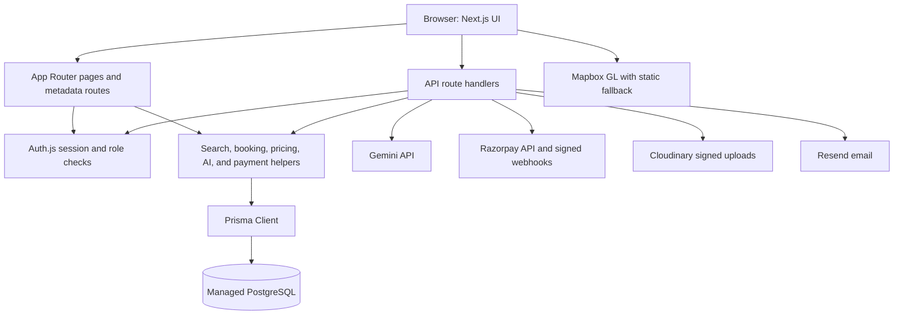

# Architecture

AI, payment, database, and Cloudinary credentials stay on the server. The Mapbox token is intentionally public and must be restricted to the deployed site origin. Prisma is the persistence boundary; booking totals and availability are recalculated by server routes before a hold is created.
